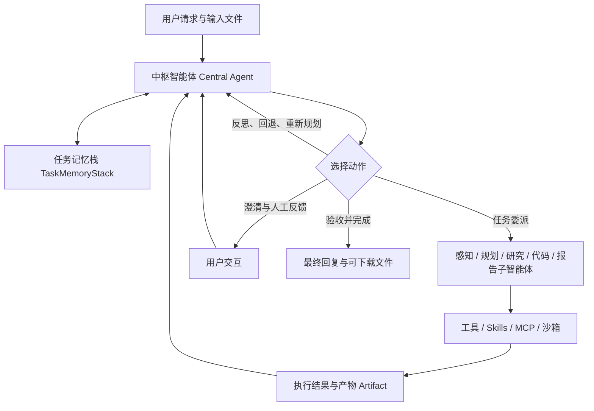

# 🚀 StackPlanner 2.0

[](./backend/pyproject.toml)
[](./frontend/package.json)
[](./LICENSE)

> 基于 DeerFlow 2.0 构建的多智能体规划系统，通过中枢决策、记忆栈和专项子智能体，完成需要持续规划、执行与验证的复杂任务。

## 📑 目录

- [项目概述](#项目概述)
- [架构设计](#架构设计)
- [快速开始](#快速开始)
- [核心组件](#核心组件)
- [配置说明](#配置说明)
- [使用示例](#使用示例)
- [开发指南](#开发指南)
- [Docker 部署](#docker-部署)
- [监控与调试](#监控与调试)
- [许可证与致谢](#许可证与致谢)

## 项目概述

StackPlanner 2.0 延续了 [StackPlanner 1.0](https://github.com/PKU-SIS/Stack-Planner) 的中枢规划与 MemoryStack 设计，将任务处理组织为一个持续迭代的过程：**分析目标、委派执行、观察结果、修正计划，直到形成可交付的结果。**

中枢智能体（Central Agent）负责决定下一步做什么，子智能体负责检索资料、处理数据、执行代码或撰写报告。执行过程中产生的关键结论与反馈进入记忆栈，完整材料和生成文件则保存为产物（Artifact），供后续步骤引用和用户下载。

2.0 基于 DeerFlow 2.0 的运行时实现，复用其会话、检查点、沙箱、工具、技能和 Web 界面，让规划过程与实际执行、结果交付连接起来。

### 主要特性

- 🤖 **中枢规划与任务委派**：根据任务需求选择子智能体，组织有依赖关系的步骤，并行执行相互独立的工作。
- 📚 **记忆栈管理**：记录决策、观察结果和修正信息，压缩历史上下文，保留重要的人类反馈。
- 🔄 **反思与重新规划**：根据失败原因调整策略、回退工作状态，或向用户集中澄清关键问题。
- 🛠️ **工具与技能扩展**：子智能体可以使用搜索、网页获取、文件操作、代码执行、Skills 和 MCP 工具。
- 📄 **产物交付与验证**：保存报告、代码和数据文件，结合执行证据检查完成情况，向用户说明尚未解决的问题。
- 🔍 **执行过程可观察**：在 Web 界面查看子任务进展、工具结果、生成文件，以及运行耗时和用量。

### 从 1.0 到 2.0

| 方面 | 2.0 的实现 |
| --- | --- |
| 中枢决策 | 通过明确的动作接口组织思考、委派、反思、总结与完成 |
| 记忆管理 | 以 `TaskMemoryStack` 保存任务记忆，结合产物引用和会话检查点维护状态 |
| 子任务执行 | 通过统一的子智能体执行器管理工具权限、执行预算、取消和进度回传 |
| 运行与交互 | 接入 DeerFlow 2.0 Gateway 和 Web 工作区，支持会话持久化与人工交互 |
| 结果验收 | 区分软件修改、数据处理与检查任务，并依据对应的执行证据验收 |

## 架构设计

系统由任务理解、中枢决策、专项执行和结果交付四个部分组成。中枢根据当前任务与记忆决定下一步动作；子智能体完成委派后，将观察结果和产物交回中枢，进入下一轮决策。



任务流程会随需求调整：简单问题可以直接回答；需要外部证据时委派检索；复杂任务可以先明确需求、形成提纲，再安排研究或实现，最后整理和验证结果。

会话状态、检查点、运行事件和文件访问由底层运行时提供支持。中枢通过控制动作组织任务，具体的搜索、代码执行和文件操作交给具有相应权限的子智能体。

## 快速开始

### 环境要求

| 环境 | 要求 |
| --- | --- |
| Python | 3.12 或更新版本，使用 `uv` 管理依赖 |
| Web 界面 | Node.js 22+、pnpm |
| 本地完整启动 | GNU Make、nginx，以及上述开发环境 |
| Docker 部署 | Docker 与 Docker Compose |
| 模型服务 | 至少一个已配置的模型；执行工具任务时需要支持工具调用 |

### 1. 获取项目

```bash
git clone https://github.com/PKU-SIS/StackPlanner2.0.git
cd StackPlanner2.0
```

### 2. 配置模型与执行环境

在项目根目录运行配置向导：

```bash
make setup
```

向导会引导配置模型服务、API 密钥、可选的搜索服务，以及沙箱与执行权限，生成本地 `config.yaml` 和 `.env`。

如果希望手动编辑完整配置，可改用：

```bash
make config
```

随后编辑根目录的 `config.yaml` 与 `.env`。完整配置项见 [config.example.yaml](./config.example.yaml)。

### 3. 安装依赖并启动

```bash
# 检查本地启动所需的依赖
make check

# 安装后端、前端依赖及开发钩子
make install

# 检查配置
make doctor

# 启动本地开发环境
make dev
```

启动后访问 **http://localhost:2026**。Web 主工作区默认使用 StackPlanner 编排；通过 API 调用时，使用 `assistant_id="stackplanner"` 选择该运行路径。

停止本地服务：

```bash
make stop
```

模型、搜索和代码执行能力取决于本地配置。默认本地沙箱关闭宿主机 Bash 执行；需要运行代码或处理数据时，应在配置阶段选择合适的沙箱并启用所需工具。Docker 启动方式见[下文](#docker-部署)。

## 核心组件

### 中枢智能体（Central Agent）

中枢负责理解目标、选择执行策略、管理任务记忆，并判断当前结果是否满足要求。它使用以下控制动作组织任务：

| 动作 | 职责 |
| --- | --- |
| `THINK` | 分析当前状态，决定下一步工作 |
| `DELEGATE` | 将具体任务委派给专项子智能体 |
| `RECALL_MEMORY` | 检索与当前任务相关的长期记忆 |
| `REFLECT` / `REVISE` | 检查已有结论并修正任务记忆 |
| `BACKTRACK` / `REPLAN` | 回退工作状态或调整后续计划 |
| `SUMMARIZE` | 压缩任务记忆，保留后续决策需要的信息 |
| `ASK_HUMAN` | 暂停执行，向用户澄清或请求反馈 |
| `FINISH` | 检查交付条件并完成任务 |

中枢会结合子任务的 `complete`、`partial`、`blocked` 状态决定是否继续执行。回退动作调整记忆、阶段或产物引用；涉及工作文件的实际恢复，需要后续执行操作完成。

### 子智能体系统

子智能体接收具体任务、必要上下文、验收要求与执行预算，在各自权限范围内工作，并回传结果。

| 子智能体 | 职责 | 适用场景 |
| --- | --- | --- |
| Perception | 理解输入与任务边界 | 文档理解、需求整理、任务澄清 |
| Outline | 构建提纲与任务依赖 | 复杂任务拆解、研究路线、报告结构 |
| Researcher | 收集与核对证据 | 事实查询、资料检索、来源比对 |
| Coder | 计算、数据处理与软件实现 | 数据筛选、算法计算、代码修改、运行验证 |
| Reporter | 基于已有材料整理交付内容 | 报告撰写、结果综合、版本修订 |
| Memory Recaller | 按需检索长期记忆 | 用户偏好、已有经验与历史信息回忆 |

Reporter 使用上游已经收集、计算并传递的材料进行写作；需要补充检索或运行代码时，由中枢安排相应执行角色。

数据处理与软件修改有各自的验收要求。例如，筛选 CSV 需要核对筛选条件与输出文件；修复软件需要检查源码改动及修改后的验证结果。系统据此决定是否需要继续执行或补充证据。

### 任务记忆栈（TaskMemoryStack）

记忆栈为中枢保存当前任务的重要信息，包括决策、委派、观察结果、反思、总结和人工反馈。完整资料与较大的文件正文通过产物引用传递，避免持续堆积在规划上下文中。

| 层次 | 保存的信息 |
| --- | --- |
| 短期任务记忆 | 当前任务的关键决策、结果、修正和反馈 |
| 工作状态与产物 | 子任务状态、文件、版本引用与会话检查点 |
| 长期记忆 | 跨会话的用户偏好和可复用经验，通过独立机制写入与召回 |

任务记忆支持选定条目的总结与修正，重要的人类反馈会受到保护。长期记忆是否启用、如何持久化，由部署配置决定。

### 产物与结果验收

报告、代码、表格和其他生成文件可以作为产物保存，并在工作区查看或下载。交付检查关注实际产物和可观察的执行证据：

- 文件任务需要对应的产物引用及交付信息。
- 软件验证需要在最新源码修改完成后执行；同批并行发出的测试不足以证明修改已经通过验证。
- 仅收集测试、查看版本或帮助信息，不作为测试通过的证据。
- 中文报告检查叙述正文，保留原始数据名称、网址、代码和引用。
- 未完成的工作保留已有结果，并说明缺口与可继续执行的步骤。

## 配置说明

运行配置位于项目根目录，通常由 `make setup` 或 `make config` 创建。

| 文件 | 用途 |
| --- | --- |
| `config.yaml` | 模型、工具、沙箱、子智能体、记忆与持久化配置 |
| `.env` | 配置中引用的 API 密钥和环境变量 |
| `extensions_config.json` | MCP 服务与扩展配置，按需创建 |
| `skills/` | 可供智能体使用的公共与自定义技能 |

### 模型与工具

以下是模型配置片段，需合并到完整的 `config.yaml` 中，并替换为实际模型名称：

```yaml
models:
  - name: main-model
    use: langchain_openai:ChatOpenAI
    model: your-model-name
    api_key: $OPENAI_API_KEY
    # 使用兼容服务时，填写其 API 地址
    # base_url: https://your-model-service.example/v1
    max_tokens: 8192
    # 按模型服务的真实上下文容量填写
    context_window: 128000
```

在 `.env` 中设置对应的 `OPENAI_API_KEY`。其他模型提供方、本地 Qwen/vLLM、搜索和网页获取工具的配置示例，见 [config.example.yaml](./config.example.yaml)；MCP 配置格式见 [extensions_config.example.json](./extensions_config.example.json)。

### 执行预算与上下文

默认配置将工具次数、图步数、超时和累计 token 用量分别管理。它们都是执行上限；任务达到其中一个约束时，可能在用完工具额度前结束。

| 参数 | 默认值 | 说明 |
| --- | --- | --- |
| 子智能体工具调用 | 50 次 | 单次委派的工具调用上限 |
| 子智能体搜索 | 8 次 | 实际网页搜索调用上限，另有去重与失败控制 |
| 整轮工具调用 | 200 次 | 中枢、所有子智能体及失败重试共享 |
| 默认并行委派 | 3 个 | 可配置为 1–4 个；通用后台调度器有 3 个工作线程 |
| 中枢控制动作 | 20 次 | 独立于工具总次数的规划预算 |
| 子智能体 / 主入口图步数 | 480 / 512 | 包含中间件等执行节点；不等于工具调用次数 |
| 子任务 / 宿主机 Bash 超时 | 1800 秒 / 120 秒 | 分别限制整个子任务和单条前台命令 |
| 子智能体累计 token | 200 万 | 默认启用，达到 70% 时提示收尾 |
| 对话压缩触发 / 保留历史 | 约 64k / 16k token | 按实际模型容量、输出预留与安全余量收敛 |

整轮工具上限由 `max_tool_calls_per_run` 配置。子智能体的超时、图步数与 token 预算可通过 `subagents` 配置，模型上下文容量通过 `models[].context_window` 声明。调大配置中的窗口数值不会改变模型服务的真实容量。

启用 `summarization.enabled` 后，Central 和 specialist 都会依据各自模型的上下文窗口压缩历史，并预留下一次输出空间。子智能体保留原始系统契约，通过独立摘要通道继续使用历史证据；压缩失败时保留原历史。Central 遇到未解析的工具调用标记或裸 SP 调用 JSON 时，会携带协议纠正提示做一次有界重试；不会执行隐藏工具或制造产物。离线评测拒绝未被解析的 Qwen 工具调用标记和聊天协议标记，避免把控制消息计为最终答案。

`VllmChatModel` 对已绑定工具、没有有效调用、但返回明显损坏工具封装的响应，使用原模型和原工具 schema 最多重问一次；普通 JSON 和正常工具调用不会触发。两次请求的 token 用量合并计入预算和日志。再次失败会记录结构化诊断，子智能体结果保持 partial，不执行损坏文本，也不替代原有文件归属、JSON 或交付检查。

Reporter 向当前 action 所属的 `outputs/*.json` 追加内容时，如果现有文件是完整合法 JSON、追加后将变成非法 JSON，`write_file` 会拒绝该次追加并保留原字节，提示读回或明确修订。未闭合文档的分块构造、空白追加、JSONL、覆盖写入和 `str_replace` 保持原有行为；此保护不把文件语法正确视为任务已经完成。

`write_file` 也支持可选的 `json_content` 对象或数组，与字符串 `content` 二选一，仅用于 `.json` 且 `append=false`。工具按 UTF-8 JSON 序列化原始值，复用同一写入、大小限制和交付检查。CLAUSE 公共 Skill 优先一次写入完整 finding 数组，较大内容仍可采用原有字符串分块方式；题目、字段、完整文档检查和 finding 数量要求保持不变。

## 使用示例

启动 Web 工作区后，可以直接输入以下任务。涉及外部数据、代码执行或额外文件格式时，需要配置相应工具、沙箱或转换能力。

### 资料研究与报告

> 调研近三年开源大模型推理框架的发展，比较各自的适用场景和部署约束。请标注来源，并生成一份中文 Markdown 报告。

中枢可以根据问题安排需求理解、提纲与资料研究，再由 Reporter 综合证据，形成可下载报告。

### 数据筛选与导出

> 筛选上传的销售数据，保留销售额大于 10000 且状态为“已完成”的记录，按地区汇总，并导出 CSV，说明筛选前后的记录数。

Coder 负责执行筛选与计算，输出数据文件，并核对结果是否满足指定条件。

### 软件修改与验证

> 检查这个项目的分页接口，修复边界条件错误，补充必要测试，并给出修改说明和测试结果。

中枢委派代码检查、实现和验证，依据实际源码改动及后续执行结果判断完成情况。

### 多轮反馈与修订

> 保留上一版报告的结构，补充本地部署的限制条件；结论按我刚才提出的三个评价标准重写，并生成新版本。

用户反馈进入任务上下文，后续子任务结合当前产物和修订要求继续工作。委派会完整传递当前用户问题，保留末尾的输出格式要求；历史消息与任务记忆仍按各自预算压缩。

同一路径的并行文件工具调用按先读后写校验串行执行；异步等待文件锁不会占满文件操作所需的工作线程，取消等待也不会留下后台锁竞争。
按行分段阅读同一文档时，不同区间分别计数，避免把连续阅读误判为重复调用；相同区间的重复调用及工具总量限制继续生效。

## 开发指南

### 代码结构

```text
StackPlanner2.0/
├── backend/
│   ├── packages/harness/deerflow/
│   │   ├── sp/                  # 中枢动作、处理器、记忆栈与编排入口
│   │   ├── subagents/           # 子智能体定义与执行器
│   │   ├── agents/middlewares/  # 上下文、用量、预算与执行控制
│   │   ├── sandbox/            # 沙箱接口与文件、命令工具
│   │   └── runtime/            # 运行生命周期、检查点与事件流
│   ├── app/gateway/            # HTTP API、会话、认证与产物访问
│   └── tests/                  # 后端与回归测试
├── frontend/                   # Web 工作区
├── skills/                     # 公共与自定义技能
├── scripts/                    # 配置、启动、部署与诊断脚本
├── config.example.yaml         # 配置模板
└── Makefile                    # 项目操作入口
```

`sp/` 是 StackPlanner 编排逻辑的主要入口；包名中保留的 `deerflow` 对应底层运行时。扩展中枢动作、专项角色或工具边界时，需要同步更新相应 Schema、角色映射和测试。

### 记忆栈示例

在后端环境中，可以通过公开的记忆接口记录一次委派与观察：

```python
from deerflow.sp.memory import TaskMemoryStack

memory = TaskMemoryStack()
memory.append_delegate(
    "按条件筛选销售数据",
    metadata={"target_agent": "coder", "task_kind": "data_processing"},
)
memory.append_observe(
    "筛选与汇总完成，结果已导出",
    actor="coder",
    metadata={"completion_status": "complete"},
)

print(memory.to_dict())
```

### 开发检查

```bash
# 后端：在 backend/ 下执行
cd backend
make test
make lint

# 前端：在 frontend/ 下执行
cd ../frontend
pnpm check
pnpm test
```

新增功能或修复问题时，应补充对应测试，并同步更新文档。测试覆盖运行时、动作路由、记忆、产物、工具预算和并发取消等路径；真实模型与搜索服务的联调需要在配置完成后单独验证。

## Docker 部署

完成根目录配置后，可使用以下方式启动。

### 开发环境

```bash
make docker-init
make docker-start

# 查看日志
make docker-logs

# 停止服务
make docker-stop
```

### 持续运行环境

```bash
# 构建镜像并启动服务
make up

# 停止并移除容器
make down
```

统一访问地址为 **http://localhost:2026**。需要保留会话、检查点和应用数据时，在 `config.yaml` 中选择 SQLite 或 PostgreSQL，并配置相应的数据持久化。

Gateway 默认使用单个 worker。Redis 事件流负责跨进程的消息传输与回放，取消和任务归属等运行状态仍需对应的部署策略；扩容前应结合实际负载验证。更多部署细节见 [CONTRIBUTING.md](./CONTRIBUTING.md)。

## 监控与调试

- **任务进度**：在工作区查看子任务、工具调用、执行结果与产物。
- **执行追踪**：在 `/workspace/debug` 为新运行启用调试，查看任务上下文、中枢动作、停止原因、耗时和用量。
- **配置诊断**：运行 `make doctor` 检查配置与依赖。
- **问题排查**：运行 `make support-bundle` 生成经过脱敏的诊断材料，用于复现和反馈问题。

执行追踪展示可观察的决策和执行信息。模型服务的私有内部推理不属于该调试接口的交付内容。

详细参考：[后端架构](./backend/docs/ARCHITECTURE.md) · [API](./backend/docs/API.md) · [配置说明](./backend/docs/CONFIGURATION.md) · [上下文压缩](./backend/docs/summarization.md) · [贡献指南](./CONTRIBUTING.md)

## 许可证与致谢

本项目采用 [MIT 许可证](./LICENSE)，保留上游项目的版权与许可声明。

StackPlanner 2.0 建立在以下项目的工作基础之上：

- [StackPlanner 1.0](https://github.com/PKU-SIS/Stack-Planner)：中枢规划、多智能体委派与记忆栈设计。
- [DeerFlow](https://github.com/bytedance/deer-flow)：会话运行时、Gateway、沙箱、工具与 Web 工作区。
- [LangGraph](https://github.com/langchain-ai/langgraph) 与 [LangChain](https://github.com/langchain-ai/langchain)：状态图执行与模型、工具集成。

欢迎通过 [Issue](https://github.com/PKU-SIS/StackPlanner2.0/issues) 和 [Pull Request](https://github.com/PKU-SIS/StackPlanner2.0/pulls) 反馈问题、分享使用经验和参与开发。


### Benchmark plugins: separate inference and evaluation

FinAuditing 可选择[原生文件检索模式](docs/DCC_FINAUDITING_FILES.md)：完整 XML 按题隔离上传，
由 SP 文件工具检索，复用官方评测器。原 RAGFlow 配置和知识库保留，两种访问方式独立使用。
RAGFlow 检索按原生运行时的用户和线程读取已准备的题目范围；后台线程缺少用户 ContextVar 时仍使用运行时身份。

NBA 与 FinAuditing 实验中的[SP harness 共性问题](docs/DCC_SP_HARNESS_FINDINGS.md)汇总了已做处理、
仍需 SP 主线解决的问题，以及数据集自身的限制。

DCC v3 supports native SP2 benchmark inference and independent offline evaluation.
Run `scripts/infer_sp_benchmarks.py` to collect final deliveries, then
`scripts/evaluate_sp_benchmarks.py` to score an existing run. Input adapters receive
only public tasks and staged UTF-8 files; labels and private metadata stay with
the evaluator. Plugins own their scoring and aggregation, including CUAD AUPR.
Collection accepts native text answers after normal graph return as well as
validated FINISH deliveries, while preserving incomplete-output and artifact gates.
Reporter checks the complete contents of declared JSON deliverables before FINISH;
invalid JSON stays partial and follows the bounded revision flow with parser
diagnostics. Revisions preserve the requested format and keep the original file.
Reporter can use `str_replace` for a small correction after reading the file
created by its current action. An explicit revision scope may request
`read_file`, `grep`, `write_file`, and `str_replace`; earlier reports retain
their ownership protection and corrected JSON still passes the full parser.
Explicit JSON output requirements also validate inline fallbacks, including
content that would otherwise be saved with a Markdown extension.
Data-processing recovery retains previously requested retrieval tools and checks
their availability and role permissions again on every retry.
Explicit data-processing Coder delegations retain their execution role even when
the task starts with document inspection or ends in a report. Retrieval JSON is
formatted across fields and chunks so externalized results can be paged with
native `read_file` line ranges; its values and sample scope remain unchanged.
Reporter recovery preserves the original validated tools and Skills within the
same unresolved run. Its three-attempt limit also applies when no report file
was produced, and the execution boundary prevents additional delegations while
retaining the incomplete result and its remaining gaps.
The retrieval tool describes its 1-indexed pages, 1-100 chunk page size, and
`total` count. Evidence coverage may need later pages; an incomplete retrieval
does not establish that a fact is absent from the source document.
Numeric research stays with the selected Researcher when its explicit tool
scope includes retrieval. Role repair also preserves an explicit data-processing
Coder contract instead of treating an API audit as retrieval alone.
The manifest records the delivery contract and results identify the delivery source.
Both native delivery extraction and saved-state classification keep known
Central empty responses and invalid control calls as policy failures
(`empty_response` or `protocol_error`); provider and unknown errors retain
`infrastructure_error` even when native middleware converts them into messages.
Benchmark runs are non-interactive by default: human-question tools are disabled,
and unresolved evidence or verification gaps remain explicit failures.
The former combined evaluation command is now evaluation-only; v2 run directories
are not silently resumed as v3. See the [benchmark guide](docs/dcc_harness.md) for
commands, plugin interfaces, completeness rules, and tests that do not execute SP2.

CLAUSE **EVAL3 In-Text (文本内部)** is available as the built-in `clause` plugin.
It audits internal discrepancies in complete contracts; the fixed custom split
contains 500 test documents and 1,809 annotated defects. CUAD retains its existing
input and AUPR protocol.

Start with the **[CLAUSE collaborator quickstart](docs/clause_quickstart.md)** for
environment setup, reproducible data downloads, model configuration, inference,
and independent seven-metric evaluation. The [protocol reference](docs/clause_benchmark.md)
explains input isolation, alignment, aggregation, and diagnostic modes.

```bash
# Run from the repository root; generates local data, without invoking SP2.
python -B scripts/dcc_prepare_clause.py --download
```

Only reconstruction code and frozen manifests/prompts/checksums are stored in Git.
The optional shared Release distributes verified contracts, annotations and task
lists separately; NLTK resources, model weights, credentials and experiment results
stay local.
The protocol is `intext-yes-whole-document-v1 / sp2-files`, not the paper's official
split or a claim of reproduced model scores. Development checks cover source reconstruction, input isolation and offline scoring;
use the `--no-sp-runtime` test option when SP execution must be excluded.

CLAUSE EVAL3 also supports an opt-in `clause_ragflow` plugin using the DCC
per-sample RAGFlow pipeline. Both file and RAG modes support L1/L2 inference and
independent seven-metric scoring. Collaborators can install the same-repository
CLAUSE Release to reuse the complete dataset and existing knowledge-base mapping
without rebuilding the vector index. RAG access requires separately authorized
service credentials. See [CLAUSE shared data, RAGFlow setup and evaluation](docs/clause_ragflow.md).

Native RAGFlow retrieval exposes chunk filenames as `document_name`, accepting
`document_name`, `docnm_kwd`, then `document_keyword` in that priority order.
It preserves XML/content bytes, document IDs, sample scope and pagination so
instance-document evidence retains its filename provenance across API versions.

DCC 基准配置 `configs/stackplanner_benchmarks.yaml` 显式设置子智能体图步数上限为 480；中枢动作上限和每题超时通过基准运行器参数设置。
StackPlanner execution budgets can be raised explicitly through trusted
`configurable` runtime settings: `sp_max_actions` (default 20, range 2–256),
`sp_report_recovery_max_attempts` (3), `sp_delegate_recovery_max_attempts` (3),
and `sp_capped_delegate_recovery_max_attempts` (2). Recovery limits are 1–32;
capped specialist retries cannot exceed ordinary retries. For example, a long
non-interactive audit may use 40 actions and recovery limits 6/6/4. These are
independent of specialist graph depth, output tokens, and loop detection. The
schema and Reporter dispatch share the effective limits; increasing them never
accepts a partial artifact. Exhaustion retains the gaps and is recorded as
`sp_recovery_exhausted` / `recovery_exhausted`, rather than a completed empty
prediction. Effective limits are included in graph metadata.

Native public output contracts use `sp_task_contract.output_schema` (local JSON
Schema) and `output_parse_mode` (`json` or `text`). FinAuditing input construction
recognizes the exact published public FinRE/FinMR/FinSM instruction templates;
it does not receive private metadata or gold. FinRE requires a raw published
label, FinMR the two required string-valued fields (including legal `0`), and
FinSM a JSON string array (including a genuine empty result). Plain-text,
Reporter files and FINISH all validate the same shape. An invalid attempted
answer starts bounded native recovery; incomplete evidence stays blocking even
when a candidate is `[]`. No format repair manufactures an answer or changes
an official scorer.

Externalized `ragflow_retrieve` results keep their complete original JSON
bytes. The preview spends the configured head+tail character budget on source
content excerpts spread across chunks, rather than document metadata. It shows
actual content line numbers for native `read_file`, matching/returned/excerpted
counts and explicit unread source markers. Excerpts do not establish complete
retrieval or an evidence audit. Larger preview budgets can show more chunks;
complete evidence remains available in the saved file.

Evidence-required native tasks carry public `source_requirements`: exact source
file paths/line counts and, for FinAuditing RAG, the sample's public document IDs.
Actual successful tool results establish read ranges and document-page coverage;
model-authored completion metadata cannot supply this proof. Truncated reads,
zero-match queries and previews remain incomplete. Missing reads trigger bounded
recovery before any final answer, including a format-valid `[]` or raw label.
CLAUSE retains its Reporter/clause audit policy and requires the complete public
document; FinAuditing retains Researcher for filing evidence. The unchanged
published NBA task template also requires Researcher to read the complete uploaded
rules. Delivery requires the designated auditor's latest current-run native
observation to be complete, without evidence gaps or any early-stop reason.
NBA template recognition uses the prompt composer's normal monetary-dollar
escaping and preserves the published salary assumptions.
Its public text contract retains the original `Answer: False.` / `Answer: True.
Illegal Operation: X. Problematic Team: Y.` ending, enabling the same complete
audit delivery path as other public schemas. Research notes that leave the
requested transaction analysis undone remain partial.
These checks do
not infer findings, require nonempty predictions or replace semantic auditing.

When no finalizable artifact exists, Central receives the actual binding protocol:
`sp_finish` is unavailable and completed conversational audits return ordinary
final assistant content in the requested public shape. After a clean public
audit and complete source coverage, Central's control tools are removed for
that final response. File-producing requests retain native artifact finalization.
The host public contract records `delivery_mode`: FinAuditing/NBA use `inline`,
CLAUSE uses `artifact`. Conditional transport guidance cannot turn an inline
answer into a file request. Incidental specialist artifacts remain context for
the inline final answer.

`ragflow_retrieve` additionally accepts an optional sample-scoped `document_id`.
With `page_size=100` it enumerates original indexed chunks without semantic
filtering; page until all chunks are received. The first per-thread/page snapshot
is cached outside the sandbox mount and retains source update time. Complete
inline results count as read; externalized results count only after actual native
reads cover their content lines. Larger documents can be read in bounded ranges.
Paging/different documents have distinct loop-detection identities; the same
request still reaches the usual cap. Native textual JSON fallback artifacts use
the published `.json` extension.
# Small public JSON deliveries

When a Reporter or contract-designated auditor returns a complete answer matching the explicit public output
schema, the native harness preserves that original response as an artifact even
below the generic large-result threshold. This includes short FinAuditing values
and CLAUSE arrays. Structured envelope artifacts remain JSON when saved; the
observed-source requirements still apply to empty and nonempty answers alike.

Public source prefetch is opt-in. The trusted run configuration may set
`sp_source_prefetch_enabled`, `sp_source_prefetch_tokenizer` (an existing local
Transformers tokenizer directory), `sp_source_prefetch_context_tokens`, and
`sp_source_prefetch_response_tokens`. Only the public contract's audit agent
prefetches its declared uploaded files and scoped document IDs. The host executes
the policy-filtered native tools through their ordinary tool interceptors and
records explicitly marked calls/results. It counts the actual tokenizer chat
template, exposed tool schemas and generation prefix, reserving the configured
reply budget plus 2,048 tokens. Oversized results use native lossless
externalization and real line reads; unread previews never satisfy source gates.
The private tokenizer path stays outside model/graph state. Native summarization
still manages subsequent model/tool history, so configure its response reserve
to match the run. Prefetch also stays below the native summarizer's actual
trigger. Host execution alone does not establish a read: an innermost model-call
observer confirms that complete original tool pairs survive all input wrappers.
Summarized or clipped originals never count as model-visible source evidence.
A single oversized source line remains incomplete until it can be read within
the model's real context.
When a file-only audit is retried after historical source coverage is complete,
native prefetch reads the original files again for the new auditor's actual
model input. Historical source proof alone does not provide that input. Mixed
RAG tasks retain missing-range/page continuation. File-only recovery also carries
the previous real draft reference and native gaps to the new delegation.

For schema-constrained deliveries, a model-declared output filename must be
actually readable before it can take precedence over generated inline content.
If the claimed file does not exist, the native fallback validates and saves the
original inline answer under its current-action filename. A receipt without
either a real file or an actual valid inline answer remains incomplete.
An actual paired successful native write also establishes current-action path
ownership, even when its filename omits the action ID; the host still reads and
validates the real file. Model-authored write claims cannot establish ownership.
Schema-valid structured empty arrays remain usable output when no summary is
present. Missing output is never converted to an empty answer. Public schema
audits use their explicit value contract and native evidence/status gates;
generic prose-report heuristics do not reject original source quotations or
require tool-example placeholder IDs in the answer.

For explicit public output schemas, successful Reporter/auditor finals use the
raw public JSON/text value directly. The harness replaces its generic outer
envelope instruction for those roles, validates the unchanged value and saves it
natively. Actual blockers still use partial/blocked envelopes with concrete gaps;
source-access and native execution checks remain mandatory.
Malformed artifact values receive up to two format corrections in the same
auditor instance, retaining its original source and draft. Completed inline
audits receive the same bounded feedback in Central instead of entering a file
Reporter workflow. The model supplies the corrected value; the host never joins
JSON objects, extracts an answer, or substitutes an empty/default response.
Exhausted correction remains incomplete. Actual blockers, provider truncation
and native guard stops retain their existing failure behavior.
When a current-run Reporter artifact array is token-capped, its next recovery
asks the model to rebuild one complete array from original sources, consolidate
repeated descriptions, and preserve every distinct supported issue and required
complete verbatim quotation. The host leaves draft bytes and acceptance checks
unchanged; inline deliveries and runtime budgets keep their existing behavior.
When required public sources remain unread, Central's next tool binding directs
the read to the contract-designated auditor with its ordinary scoped tools;
unrelated perception/coder retries do not consume the audit before it begins.
Later delegations resume the host's actual same-run source ledger: skip covered
files/documents, read only missing file ranges, and continue unread content lines
in already externalized native RAG pages. Existing evidence paths remain the
source of truth, so repeated prefetch cannot spend its budget on the same prefix.
