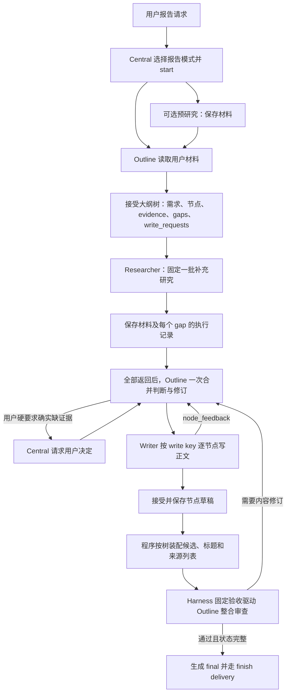

# zx_sp2research：报告流程与 Skills / Tools 分支对照

## 1. 对比范围与结论

- 原分支：本地 `main`，提交 `1459577`。
- 当前分支：`zx_sp2research`，提交 `b798814`。
- 两个提交间共 92 个文件变化，新增约 2.17 万行，包含实现、测试和文档。
- 本次没有启动服务或调用付费模型；之前启动和简单对话的验证发生在 `main`。

当前分支新增 `backend/packages/harness/deerflow/sp/report/`，实现独立的报告业务状态和完整生命周期。报告模式采用专用的技能、工具与输入包，由 Outline 规划和判断内容，由 Writer 逐节点写正文，再由程序装配、验收并交付。

普通任务仍保留既有编排路径，普通单次 Reporter 综合仍使用 `stackplanner-reporting`。报告模式按请求语义选择；保存文件本身不意味着进入报告模式。

## 2. 核心差异

| 方面 | 原 main | 当前 zx_sp2research 的报告模式 |
| --- | --- | --- |
| 报告规划 | Central 编排，Outline 提供阶段大纲 | Outline 持有结构、论证、证据选择和内容判断职责 |
| Central | 选择角色、技能和步骤 | 调度报告生命周期、研究请求和写作请求，读取账本派生的控制摘要 |
| 报告写作 | Reporter 一次综合完整报告 | Writer 每次处理一个已准备好的 writable 节点 |
| 默认报告 Skill | `stackplanner-reporting` | `report-outline`、`report-research`、`report-node-writing` |
| 工具绑定 | 角色默认策略和 Central 传入的技能/工具选择 | 运行时按报告角色定向绑定，忽略 Central 自填的角色技能/工具白名单作为权限依据 |
| 证据传递 | 阶段产物正文和来源引用 | 已保存材料、稳定 source/material ID、行范围和节点 evidence 字段 |
| 业务状态 | 任务记忆与产物引用 | 文件账本 `ledger.json` 为报告业务状态权威，产物为登记视图 |
| 修改 | 再生成完整报告版本 | Outline 判断草稿 keep/rewrite/drop，按节点局部重写 |
| 最终交付 | 最终产物引用及类型门禁 | 节点完整性、候选装配、整合审查、final 与 delivery 的完整状态约束 |

## 3. 报告模式实际绑定的 Skills 与 Tools

下表来自 `configure_report_subagent()`。只读文件工具集合为 `read_file`、`grep`、`glob`、`ls`，普通工具需在部署配置中可用。

| 角色/阶段 | 注入的 Skill | 实际绑定工具 | 职责 |
| --- | --- | --- | --- |
| Central | 保留技能索引；另注入 `REPORT_CENTRAL_PROMPT` 与账本控制摘要 | 原有 `sp_*` 动作 | start/resume/close、派发研究与写作、HITL；不编辑报告树、不裁决证据充分性 |
| Outline：plan / revise | `report-outline` | 只读文件工具、`write_file`、`report_register_research_request`、`report_save_user_material` | 读取材料，规划树和写作请求，登记研究缺口，判断研究结果和草稿处置 |
| Researcher | `report-research` | 只读文件工具、配置可用时的 `web_search`、`report_fetch_material` | 执行已分配的研究问题，保存材料并返回执行情况；不判断缺口是否解决 |
| Writer | `report-node-writing` | 只读文件工具、`write_file` | 依据节点规格和定位证据，只写分配节点正文到 host 指定路径，或返回 node_feedback |
| Outline：integrate_review | `report-outline`，附整合审查专用提示词 | 只读文件工具 | 审查已装配候选，提供 findings 和契约允许的局部编辑；此阶段没有写入和研究登记工具 |

补充约束：

- Writer 对外仍调用 `target_agent="reporter"`，必须携带有效 `metadata.report_write_key`；内部绑定 `report_role="writer"`。没有新增可直接委派的 `writer` target。
- Writer 使用专用系统提示词，运行时显式设置 `thinking_enabled=False`。
- 活动报告中缺少 write key 的 Reporter 调用会报错，不自动退回普通整篇综合。
- 普通 Perception、Coder 和 Memory Recaller 仍存在；专用报告链路核心为 Outline、Researcher、Writer。模式切换没有自动给所有角色安装新的 Skill。
- 三个报告 Skill 是运行时定向选择的正文。原来的 `deep-research`、`consulting-analysis` 等技能并非报告模式默认叠加项。

关键实现：[hooks.py](../backend/packages/harness/deerflow/sp/report/hooks.py) 的 `configure_report_subagent()`；接线：[sp/runtime.py](../backend/packages/harness/deerflow/sp/runtime.py)。

## 4. 两个新增工具类别

### 4.1 Outline 的登记工具

- `report_register_research_request`：登记带稳定 gap ID 的研究需求，关联用户要求、已检查材料、问题和停止条件。后续追加研究受到用户授权和当前 gap 状态限制。
- `report_save_user_material`：把 host 保存的用户原始输入登记为可引用材料，返回 source/material 身份，避免让模型重写用户原文来冒充来源。

相关代码：[tools.py](../backend/packages/harness/deerflow/sp/report/tools.py)、[materials.py](../backend/packages/harness/deerflow/sp/report/materials.py)。

### 4.2 Researcher 的材料抓取工具

报告 Researcher 看到的是 `report_fetch_material`。该工具包装部署配置中的 `web_fetch`，保存真实返回内容并登记来源、材料版本、哈希和可定位范围，返回可读材料路径。报告 Researcher 不直接绑定原始 `web_fetch`。

使用 direct_fetch 提供方时，代码还支持识别 PDF 并调用既有转换器保存为 Markdown；转换失败、无有效正文等情况保留失败状态。其他提供方按其实际返回文本保存并记录截断信息。

当前本地 `config.yaml` 仍配置 Jina `web_fetch`，切换分支并没有把它改成 direct_fetch。Jina 材料可能带上游截断限制，包装工具不会凭空恢复未返回的全文。

相关代码：[materials.py](../backend/packages/harness/deerflow/sp/report/materials.py)。

## 5. 当前报告流程



完整用户材料可直接进入 Outline，不强制预研究。当前补充研究策略是：初始大纲根据真实写作需要登记目标，执行固定一批，所有选中目标返回后统一交给 Outline 判断。搜索成功、零结果、部分结果和技术失败都结束本次 attempt，不自动无限追加研究；技术失败不冒充有效搜索轮次。

新研究或继续研究需要遵循用户输入/授权与账本状态。只有 Outline 的 `gap_outcomes` 可以关闭缺口。某些旧阶段文档提到的两轮策略不能替代当前提示词和账本实现。

当前固定验收由 Harness 的 `acceptance.py` 驱动；它复用既有 Outline review/revise 和 finish 交付路径，记录同一账本中的 acceptance 状态，不新建常驻 Reviewer。早期 P3 文档里由 Central 主动触发整合审查的描述已被后续固定验收接线扩展。

相关代码：[prompts.py](../backend/packages/harness/deerflow/sp/report/prompts.py)、[ledger.py](../backend/packages/harness/deerflow/sp/report/ledger.py)、[acceptance.py](../backend/packages/harness/deerflow/sp/report/acceptance.py)。

## 6. 文件、草稿与交付

报告数据位于当前线程 outputs 下：

```text
report/current.json
report/<report_id>/
  request.md
  user_inputs/
  ledger.json
  materials/
  research/
  tree/
  drafts/<node_id>/<draft_id>.md
  assembly/
  review/
  final/
```

Outline 输出可校验的树；节点携带要求、论证、证据定位、状态和写作请求。Writer 只写节点正文，标题由 host 按 Outline 树输出。引用使用稳定的 `[S<n>]` 来源 ID。

程序负责树与材料身份校验、草稿和审查绑定、按父子顺序装配、文件哈希和版本状态，以及 final/delivery 记录。事实支持程度和语义判断由 Outline 承担，结构校验不等于自动验证事实真实性。

实现：[store.py](../backend/packages/harness/deerflow/sp/report/store.py)、[tree.py](../backend/packages/harness/deerflow/sp/report/tree.py)、[writing.py](../backend/packages/harness/deerflow/sp/report/writing.py)、[assembly.py](../backend/packages/harness/deerflow/sp/report/assembly.py)。

## 7. 本地配置与验证边界

- 切换分支保留了 gitignored 的 `config.yaml`、`.env` 和本地依赖；当前仍使用本地 DeepSeek 配置、DuckDuckGo 搜索、Jina 抓取及文件工具。
- 两个分支的后端依赖清单和锁文件、前端依赖清单和锁文件没有差异。
- 报告专用的登记和材料工具由运行时创建，不要求把它们逐项加入 `config.yaml`。
- 当前本地仍未配置 bash，且 `allow_host_bash=false`。新的核心 Markdown 报告链路使用文件与检索工具；需要脚本执行的图表、数据处理等扩展需求仍受该配置限制。
- 服务保持停止，没有把 main 的启动结果当作当前分支复杂报告验证结果。

本次在当前分支、复用本地依赖，运行以下定向测试：

```bash
cd backend
PYTHONDONTWRITEBYTECODE=1 PYTHONPATH=.:packages/harness \
  .venv/bin/python -m pytest \
  tests/test_sp_runtime_context.py \
  tests/test_sp_report_prompts.py \
  tests/test_sp_report_wiring.py \
  tests/test_sp_report_acceptance_wiring.py \
  -q --disable-warnings
```

结果：**87 passed in 3.74s**。覆盖运行上下文、部分角色装配、报告提示词、研究派发和固定验收接线；不等于真实模型研究、写作质量及完整报告交付已通过实测。
