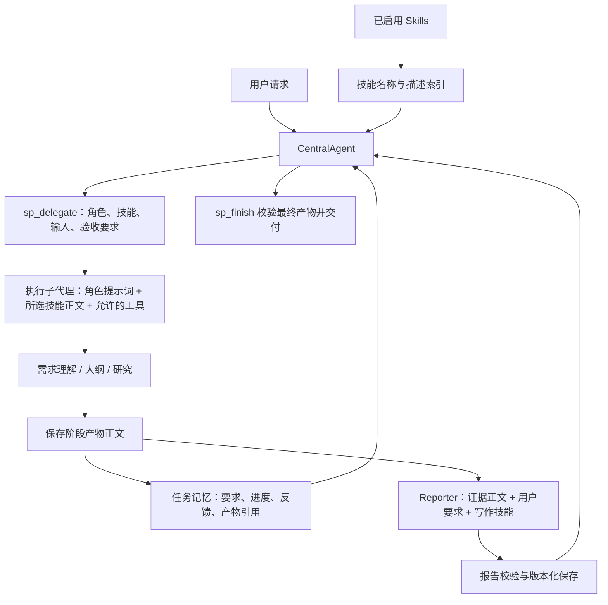

# StackPlanner2：从 Skills 注入到报告生成的实现链路

> 分支说明：本文记录此前 `main`（`1459577`）的实现。切换到 `zx_sp2research` 后，专用报告模式已经改为大纲树、研究缺口、节点 Writer 和程序装配链路。当前分支请优先阅读 [报告模式与 Skills/Tools 分支对照](STACKPLANNER2_RESEARCH_BRANCH_COMPARISON.md)。本文仍可用于理解保留的普通子代理和单次 Reporter 综合路径。

本文依据当前仓库代码，说明用户请求如何经过 Skills 路由、CentralAgent 编排、子代理执行、证据传递，最终成为可交付的报告。

运行状态：本次启动验证使用的 Gateway、Frontend 和 Nginx 已停止，10081、10082、10083 端口已确认释放。

验证范围：已验证服务启动、前端初始化页面、当前 `.env` 配置的 DeepSeek API，以及 StackPlanner CentralAgent 的简单对话。下文的复杂报告流程来自代码阅读，尚未进行完整端到端实测。

## 1. 整体架构

当前系统以 DeerFlow 的 Gateway、LangGraph 和 SubagentExecutor 为运行底座，在其上增加 StackPlanner 的控制动作、任务记忆和产物协议。

职责分为四层：

| 层次 | 负责什么 | 主要实现 |
| --- | --- | --- |
| CentralAgent | 判断下一步、选择角色和技能、处理反馈与结束条件 | `sp/runtime.py`、`sp/central/prompt.py` |
| Skills | 为具体执行提供方法、约束和输出规范 | `skills/public/*/SKILL.md` |
| 子代理 | 使用被允许的工具，完成一次有边界的委派 | `subagents/executor.py`、`subagents/builtins/sp_specialists.py` |
| 产物与任务记忆 | 保存正文、维护版本和来源，并为下一轮决策提供状态 | `sp/artifacts/`、`sp/memory/`、`sp/middlewares/` |



图中展示常见报告路径。实际阶段由 Central 根据任务和已有结果选择，可能跳过、补充或重做某个阶段。

## 2. 请求如何进入 StackPlanner

前端的产品默认 Assistant ID 为 `stackplanner`。Gateway 根据该 ID 选择 `make_sp_agent()`，构建 StackPlanner CentralAgent。

`make_sp_agent()` 复用底层 Agent 循环，注入 StackPlanner 控制提示词、运行上下文和中间件。Central 对模型暴露的可调用工具仅为 `sp_*` 控制动作，例如：

- `sp_recall_memory`：召回历史可复用信息。
- `sp_delegate`：向执行子代理派发任务。
- `sp_reflect`、`sp_backtrack`、`sp_replan`：诊断、回退和调整计划。
- `sp_summarize`：压缩任务记忆。
- `sp_ask_human`：请求人类输入。
- `sp_finish`：检查完成条件并结束。

搜索、读写文件和代码执行等普通工具交给子代理。这个边界由构建时的工具集和运行时策略共同实现。

相关代码：

- [前端默认 Assistant ID](../frontend/src/core/branding.ts)
- [Gateway 选择 Agent 工厂](../backend/app/gateway/services.py)
- [当前 StackPlanner 运行入口](../backend/packages/harness/deerflow/sp/runtime.py)：`make_sp_agent()`

## 3. Skills 的两层注入

### 3.1 发现已启用技能

`get_enabled_skills_for_config()` 根据配置和用户范围加载技能。存储层发现 `SKILL.md`，解析元数据，合并启用状态，再执行过滤。

来源包括仓库公共技能和用户自己的自定义技能；兼容路径还允许加载旧的全局自定义技能。若指定的 Agent 配置包含技能白名单，会继续收窄可用集合。

相关代码：

- [技能加载入口](../backend/packages/harness/deerflow/agents/lead_agent/prompt.py)：`get_enabled_skills_for_config()`
- [技能发现与启用状态过滤](../backend/packages/harness/deerflow/skills/storage/skill_storage.py)：`load_skills()`
- [用户范围的技能存储](../backend/packages/harness/deerflow/skills/storage/user_scoped_skill_storage.py)

### 3.2 Central 注入技能索引

`build_sp_central_runtime_context()` 把已启用技能整理为名称和描述，放进 Central 的系统提示词：

```text
<available_skills>
- {"name": "stackplanner-reporting", "description": "..."}
- {"name": "其他已启用技能", "description": "..."}
</available_skills>
```

Central 使用索引选择能力。技能索引总预算为 7,000 字符，单条描述上限为 320 字符；空间不足时优先缩短描述，尽量保留技能名称。

Central 选择的技能名称通过委派参数 `metadata.skill_names` 传递。

实现：[central/runtime_context.py](../backend/packages/harness/deerflow/sp/central/runtime_context.py) 的 `_load_skills()`、`_skill_index()` 和 `build_sp_central_runtime_context()`。

### 3.3 子代理注入技能正文

运行时先校验技能是否可用，再将本次选择应用到子代理配置。`SubagentExecutor` 随后加载对应的 `SKILL.md` 正文。

最终模型输入的核心结构为：

```text
SystemMessage
  ├─ 专家角色提示词
  ├─ <skill name="技能名">SKILL.md 正文</skill>
  ├─ 工具执行预算（适用时）
  └─ 延迟加载工具的目录（适用时）

HumanMessage
  └─ 本次委派的结构化任务、证据与验收要求
```

实现细节：`_load_skill_messages()` 先构造技能消息，`_build_initial_state()` 再将角色提示词与这些技能正文合并为一个 `SystemMessage`，兼容要求系统消息位于开头的模型接口。

技能配置语义为：`None` 表示加载全部已启用技能，`[]` 表示不加载技能，名称列表表示仅加载选中的技能。

本次显式传入的有效 `metadata.skill_names` 会替换角色默认技能选择。普通报告委派省略该字段时，Reporter 使用默认的 `stackplanner-reporting`。

相关代码：

- [技能选择和工具策略](../backend/packages/harness/deerflow/sp/runtime.py)：`_apply_task_skill_policy()`
- [加载正文及构造模型输入](../backend/packages/harness/deerflow/subagents/executor.py)：`_load_skill_messages()`、`_build_initial_state()`

## 4. Central 如何逐步推进报告任务

Central 的提示词定义三种主要执行方式：

| 工作流 | 场景 | 常见执行方式 |
| --- | --- | --- |
| Direct | 简单解释、当前信息足够 | 直接回答 |
| Bounded execution | 有一个明确的执行需求 | 最少次数委派，检查结果后交付 |
| Deliberate | 复杂研究、多阶段任务、较大报告 | 需求理解、必要澄清、大纲、研究、验证和版本化交付 |

新会话的策略要求先通过 `sp_recall_memory` 召回历史可复用信息；后续根据当前任务记忆判断是否还需要召回。

复杂报告常见的角色分工为：

| 角色 | 执行内容 | 典型产物类型 |
| --- | --- | --- |
| `perception` | 理解目标、交付物、受众、约束、上传材料和信息缺口 | `perception_observation` |
| `outline` | 建立章节结构或带依赖关系的研究计划 | `outline` |
| `researcher` | 搜索、获取来源、核对证据并保留 URL | `research_observation` 等 |
| `coder` | 在需要时处理本地计算、数据或代码任务 | `generated_file` 等 |
| `reporter` | 基于已有证据撰写或修改完整报告 | `report_revision` |

这里的阶段选择主要由模型遵循提示词完成；运行时负责执行委派、过滤权限、记录结果和检查约束。独立任务可并行委派，有依赖的任务按结果推进。

`stackplanner-long-task` 提供长任务阶段与输出规范，但并非所有角色默认加载该技能。Reporter 的默认技能是 `stackplanner-reporting`；其他技能由本次委派和角色配置决定。

相关代码与规范：

- [Central 工作流策略](../backend/packages/harness/deerflow/sp/central/prompt.py)
- [专家角色配置](../backend/packages/harness/deerflow/subagents/builtins/sp_specialists.py)
- [长任务技能](../skills/public/stackplanner-long-task/SKILL.md)

## 5. 一次委派如何变成可执行任务

Central 的 `sp_delegate` 调用包含以下核心字段：

| 字段 | 含义 |
| --- | --- |
| `target_agent` | 本次执行角色 |
| `task` | 具体任务 |
| `reason` | 选择该动作的可审计依据 |
| `stage` | 本次工作的阶段 |
| `input_refs` | 上传文件、来源或已有产物引用 |
| `expected_output` | 预期结果与验收条件 |
| `metadata.skill_names` | 本次选择的技能 |
| `metadata.tool_names` | 希望收窄到的工具集合 |

`DelegateHandler` 补齐上下文，将它构造成 `SPSubagentTask`。任务还包含线程与运行 ID、验收条件、预算和允许的工具等字段。

适配器将任务渲染为 `<sp-subagent-task>` 包裹的 JSON，交给现有 `SubagentExecutor` 执行。这是 Central 与执行子代理之间的内部消息协议；当前调用链复用同一运行体系里的执行器。

工具最终受角色限制、本次任务策略和技能工具约束共同过滤，Central 指定工具不会绕过这些限制。

相关代码：

- [委派 Handler](../backend/packages/harness/deerflow/sp/actions/handlers/delegate.py)：`handle()`
- [子代理执行器接入](../backend/packages/harness/deerflow/sp/runtime.py)：`DR2SPExecutorProvider`
- [任务渲染与结果解析](../backend/packages/harness/deerflow/sp/subagents/dr2_adapter.py)：`render_sp_subagent_prompt()`

## 6. 阶段结果如何积累，并传给 Reporter

### 6.1 摘要与正文分开保存

子代理被要求返回以下结构：

```json
{
  "summary": "供 Central 决策使用的简短完成说明",
  "artifact_content": "完整研究、大纲或报告正文；已创建文件时可为空",
  "artifact_type": "research_observation",
  "artifact_metadata": {
    "completion_status": "complete",
    "sources": [],
    "created_paths": [],
    "evidence_gaps": []
  }
}
```

完整正文保存为产物，任务记忆记录摘要、阶段、状态和产物引用。委派观察摘要预算为 700 字符。结果若为 `partial`、`blocked` 或因预算提前结束，会保留对应状态和缺口。

### 6.2 每轮决策注入最新任务状态

`TaskMemoryMiddleware` 在模型调用前生成 `<sp-task-context>`，以隐藏于界面的上下文消息注入。内容包含任务记忆、关键反馈、阶段进度、产物引用和报告版本等。

Central 据此判断哪些阶段已完成，当前缺什么，是否需要补充研究、恢复失败任务或进入报告阶段。

实现：[task_memory_middleware.py](../backend/packages/harness/deerflow/sp/middlewares/task_memory_middleware.py) 与 [context_builder.py](../backend/packages/harness/deerflow/sp/prompt/context_builder.py)。

### 6.3 给后续角色补充真实产物正文

委派给 `outline`、`researcher`、`reporter` 时，Handler 会选择相关阶段产物并读取正文，放进：

```text
context_refs.artifact_bodies.items[]
  ├─ artifact_id、type、version
  ├─ virtual_path、artifact_url
  ├─ summary
  ├─ content
  └─ truncated
```

当前正文预算如下，单位均为字符：

| 接收方 | 最多产物数 | 总正文预算 | 单个正文上限 |
| --- | ---: | ---: | ---: |
| Reporter | 16 | 96,000 | 24,000 |
| Outline / Researcher | 10 | 48,000 | 16,000 |

各产物还会按剩余预算分配空间，实际单项内容可能低于上限。截断会显式标记，Reporter 被要求披露影响结论的证据缺口。

所有专家还可收到单独有长度预算的 `mandatory_requirements.human_feedback`。Reporter 进一步收到 `report_requirements`，其中可包含反馈、修改原因、必须保留的标识、特定数值修正、语言、受众和风格要求。

实现：[delegate.py](../backend/packages/harness/deerflow/sp/actions/handlers/delegate.py) 的 `_materialize_stage_artifacts()`、`_report_requirements()`，以及 [handlers/context.py](../backend/packages/harness/deerflow/sp/actions/handlers/context.py)。

## 7. Reporter 如何生成报告

Reporter 的输入由四部分组成：

1. **角色提示词**：定义综合写作职责和输出协议。
2. **`stackplanner-reporting` 正文**：提供证据处理、报告组织、引用和修改规范。
3. **本次任务与验收要求**：说明写什么、为谁写、达到什么条件。
4. **证据与反馈**：阶段产物正文、来源引用、用户要求；修改时包括旧报告。

Reporter 默认继承父级模型，默认技能为 `stackplanner-reporting`。默认禁止搜索、Shell、进一步委派等操作；报告委派会确保请求包含 `read_file`、`write_file`，实际工具仍需存在于运行配置并通过策略过滤。

写作约束包括：

- 使用提供的事实与证据，保留来源标题和 URL。
- 区分事实、分析推断和建议，披露冲突、截断和缺失信息。
- 遵循用户指定的语言、受众、风格和长度。
- 较大分析报告默认包含标题、关键发现、范围、分析、结论、局限和来源列表。
- 修改时生成完整新版本，并保留仍有效的章节、引用和材料。
- 在元数据中记录来源产物、质量检查和剩余缺口。

当前报告主路径生成 Markdown。PDF、Word 或其他格式需要额外技能与执行步骤，这个 Reporter 配置本身没有自动排版导出阶段。

规范与实现：[stackplanner-reporting/SKILL.md](../skills/public/stackplanner-reporting/SKILL.md)、[sp_specialists.py](../backend/packages/harness/deerflow/subagents/builtins/sp_specialists.py) 的 `REPORTER_CONFIG`。

## 8. 报告如何保存、检查和交付

### 8.1 两种保存方式

| 方式 | 子代理返回什么 | 系统如何处理 |
| --- | --- | --- |
| Reporter 直接写文件 | 新文件路径放入 `created_paths`，`artifact_content` 可为空 | 验证并注册已有文件 |
| Reporter 返回正文 | 完整正文放入 `artifact_content` | `SPArtifactAdapter` 将正文写成产物文件 |

长报告优先使用独立路径 `/mnt/user-data/outputs/report-<action_id>.md`。修改报告要求创建新文件或返回完整新正文，保留旧版本。

产物元数据记录 `artifact_id`、类型、版本、来源、父产物 ID、反馈 ID、内容哈希和访问 URL，并更新 `artifacts`、`sp_current_artifact_refs` 等线程状态。报告初稿也使用 `report_revision` 类型，版本号用于区分先后。

实现：[artifacts/adapter.py](../backend/packages/harness/deerflow/sp/artifacts/adapter.py) 的 `write_text_artifact()`、`register_existing_artifact()`。

### 8.2 提示词自检与代码校验

Reporter 根据角色和 Skill 进行质量自检；Handler 还执行部分可程序化检查：

- 新文件路径是否符合当前 action 的报告文件约定。
- 必须保留的标识和特定修正是否出现在正文中。
- 是否含不适合交付的本地文件链接。
- 语言是否与请求对齐。
- 部分表格阈值、变化量和边界表述是否矛盾。
- 明确缺少数据时是否出现无依据结论。
- 部分标识来源与新旧来源优先关系是否符合要求。

发现问题后记录 `quality_checks` 和 `evidence_gaps`，可将结果标记为部分完成，交给 Central 决定修复动作。这些规则具有特定检测范围；事实可靠性仍依赖研究证据、来源质量和综合过程。

实现：[delegate.py](../backend/packages/harness/deerflow/sp/actions/handlers/delegate.py) 的 `_apply_report_acceptance_checks()`。

### 8.3 版本化修改与完成门禁

用户提出修改后，反馈会进入任务记忆；新一轮 Reporter 接收修改要求和旧报告，再生成带父产物、来源及反馈关联的新版本。重复委派 Reporter 时，Handler 要求明确修改原因和当前报告引用。

Central 最后调用 `sp_finish`。对于文件交付，它使用最终产物引用和所需产物类型声明交付目标。Handler 检查引用、类型与完成状态，并拒绝仍有待处理人类交互、与未完成兄弟动作同时结束、或用旧产物冒充本轮修改结果等情况。

实现：[finish.py](../backend/packages/harness/deerflow/sp/actions/handlers/finish.py) 的 `FinishHandler.handle()`。

## 9. 一个典型执行示例

以下是代码支持的常见执行路径示意，不是本次已经跑过的报告测试记录。

用户请求：根据上传材料和公开信息，生成一份中文行业分析报告。

```text
用户请求
  → Central 读取技能索引与任务状态
  → 新会话执行一次记忆召回
  → perception 理解需求、检查上传材料
      → 保存 perception_observation
  → 必要时由 Central 汇总澄清问题并等待用户回答
  → outline 建立报告结构和证据需求
      → 保存 outline
  → researcher 按计划获取和核对证据
      → 保存 research_observation / evidence_bundle
  → Central 检查阶段结果与缺口，必要时补充研究
  → reporter
      输入：写作 Skill + 任务 + 证据正文 + 用户要求
      输出：完整 Markdown 报告或新建文件路径
  → Handler 校验，产物系统登记版本与来源
  → Central 检查结果，必要时修订
  → sp_finish 校验最终报告产物并结束
  → 前端根据线程产物状态提供预览和下载
```

## 10. 建议的源码阅读顺序

以下路径均相对仓库根目录：

| 顺序 | 文件 | 阅读重点 |
| --- | --- | --- |
| 1 | `backend/app/gateway/services.py` | 请求如何选中 StackPlanner |
| 2 | `backend/packages/harness/deerflow/sp/runtime.py` | Central 构建、技能策略与子代理执行器接入 |
| 3 | `backend/packages/harness/deerflow/sp/central/runtime_context.py` | SOUL 与技能索引注入 |
| 4 | `backend/packages/harness/deerflow/sp/central/prompt.py` | 动态阶段选择与角色职责 |
| 5 | `backend/packages/harness/deerflow/sp/actions/handlers/delegate.py` | 任务组装、正文传递、结果处理与报告校验 |
| 6 | `backend/packages/harness/deerflow/subagents/executor.py` | 技能正文和工具如何进入子代理 |
| 7 | `backend/packages/harness/deerflow/subagents/builtins/sp_specialists.py` | 专家角色提示词和默认能力 |
| 8 | `skills/public/stackplanner-reporting/SKILL.md` | 报告写作与修改规范 |
| 9 | `backend/packages/harness/deerflow/sp/artifacts/adapter.py` | 正文落盘、产物注册与版本维护 |
| 10 | `backend/packages/harness/deerflow/sp/actions/handlers/finish.py` | 最终交付条件 |
